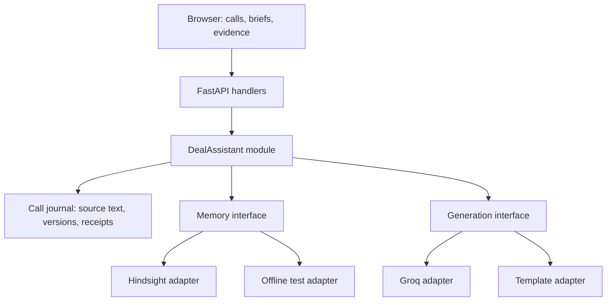

# Technology and architecture review

Date: 2026-09-29. Scope: this repository's current Deal Intelligence Agent, evaluated against its actual implementation, the supplied problem statement, installed SDK source, and first-party documentation. This is an assessment and proposed design, not a completed refactor.

## Decision

Keep Python, FastAPI, the small browser UI, and Hindsight. The important work is making memory behavior correct and demonstrable. A framework migration would not resolve the observed retry, client-lifecycle, call-context, and evidence problems. This is an engineering recommendation based on the findings below, not a comparative framework benchmark.

The concept fits the challenge: the organizers explicitly propose a Deal Intelligence Agent. It needs differentiation through changing deal state and justified next actions, rather than merely recalling names. Hindsight is mandatory; the current running configuration is an offline simulator with no Groq key. Prior passing tests did not establish a working cloud integration. [Problem statement](https://docs.google.com/document/d/1A4ezag02em823ZzYF34DiUVHUNLWI5ztm70QvWidWoQ/edit), [local assessment](project-review.md), [configuration behavior](../app/main.py).

## What was verified

- The existing suite passes: **21 tests**, with a Starlette/httpx deprecation warning. This covers local behavior and mocked Hindsight response shapes, not a real Hindsight instance. [Tests](../tests/test_regressions.py).
- An isolated local HTTP fixture reproduces a transport error when two distinct threads share the installed `hindsight-client==0.10.1` instance. This uses the actual SDK network path, not a mocked SDK method.
- Temporary-file probes reproduce silently ignored changed content under an existing call ID and a baseline response that fails when memory counting fails.
- Static call-path accounting finds **46 synchronous retain requests plus 9 count requests** for the nine synthetic demo calls, before subsequent UI refresh requests. These are request counts inferred from executed sentence splitting, not measured provider latency. [Call logging](../app/agent.py), [demo data](../app/deals.py), [seed route](../app/main.py).
- No live cloud account, credentials, customer data, or connected browser was used. The implementation remains unchanged by this research pass.

## Findings, ordered by impact

### P0: Shared Hindsight client crosses incompatible event loops

`app.main` constructs one global memory adapter. Its synchronous routes may run on different FastAPI worker threads. In the installed SDK, the synchronous wrapper uses the calling thread's event loop, while the generated transport lazily retains an aiohttp session. Those two lifecycles do not safely align. FastAPI documents that normal `def` route functions run in a thread pool. [FastAPI concurrency](https://fastapi.tiangolo.com/async/#path-operation-functions), [main.py](../app/main.py), [memory.py](../app/memory.py).

Reproduction: serve a valid empty memory-list JSON response on a temporary localhost HTTP server; create one Hindsight client; call `list_memories` in thread A; keep A alive; call the same client in thread B. A returns `total=0`; B raises **`RuntimeError: Timeout context manager should be used inside a task`**. This establishes an SDK client-sharing defect under this scheduling pattern. It does not imply every request fails: calls on the owning thread can succeed.

Before claiming a live demonstration is ready, choose and verify one coherent ownership model. Preferred target: create/close the client in application lifespan, use async SDK methods on that same application loop, and make all remote paths async end to end. A smaller alternative is a request-scoped synchronous client created, used, and closed within one worker operation. That adds connection setup but is easier to isolate. Never fix this by merely changing route declarations to `async def` while calling the SDK's synchronous wrappers. [Lifespan ownership](https://fastapi.tiangolo.com/advanced/events/), [Hindsight investigation](hindsight-research.md).

### P1: A call ID does not have a defined correction contract

The local adapter returns an existing document ID without checking whether the content changed. A probe records `Budget approved at 40000.` and then `Budget approved at 50000.` using the same call ID; the only stored text remains `40000`. The response nevertheless reports the submitted new text as retained. [Local retain](../app/memory.py), [log_call](../app/agent.py).

The browser normally creates a new ID when its current submission changes, but clients can reuse IDs and interrupted workflows can retry. Provider document identity is not a complete application idempotency protocol. Define this explicitly: same request ID plus same payload returns the prior receipt; same request ID plus different payload yields a conflict; intentional corrections get a new version referring to the earlier call. A durable content hash and receipt make this observable. Verify remote replacement and retry semantics against the actual Hindsight deployment. [Browser submission logic](../static/index.html), [provider research](hindsight-research.md).

### P1: Sentence-level writes discard useful call context

The sample Rohan interaction becomes separate sources such as `Met Rohan Iyer ...`, `He worries drivers won't adopt a new app.`, and `Liked our Hindi/Telugu driver UI when shown.` These retain calls do not provide the full surrounding call as context. That introduces a pronoun-resolution risk; the resulting Hindsight extraction quality was not measured. The local keyword engine cannot validate that risk. [Sentence splitting and metadata](../app/agent.py).

Retain one complete call as a document, with the call's date, speaker information when known, and a stable source ID. Let Hindsight extract facts from connected text. Keep deterministic domain fields separately when they represent business decisions. This should also reduce this demo from dozens of top-level writes toward one write per call; measure latency and extraction quality after the change rather than predicting a speedup. [Hindsight retain documentation](https://hindsight.vectorize.io/developer/api/retain).

### P1: The baseline is neither provider-independent nor a controlled memory experiment

`brief(use_memory=False)` avoids retrieval but still calls `memory.count(bank)` before returning. An unavailable memory provider therefore breaks the baseline too; a temporary probe confirmed that exception. The current comparison also uses Hindsight reflection for populated memory but Groq/templates for baseline generation. It illustrates two workflows, not the isolated causal effect of memory. [Brief implementation](../app/agent.py), [comparison UI](../static/index.html).

Make the baseline independent of the memory provider. For a fair memory-effect experiment, hold generator, prompt structure, sampling parameters, and deal profile constant while toggling supplied evidence. Show Hindsight reflection separately as a product capability. If keeping the current comparison for time reasons, preserve its explicit workflow-comparison labeling.

### P1: Sequential remote work dominates the demo path

A populated Hindsight brief currently invokes four recalls, one list, reflection, and one count: seven top-level SDK calls. Reflection itself can perform retrieval, so the preceding work may duplicate effort. The seed route executes 55 top-level provider calls for nine sample calls. There is no measured cloud latency here. [Brief and call functions](../app/agent.py), [provider reflection research](hindsight-research.md).

Choose one brief path deliberately: either direct reflection with returned evidence, or explicit retrieval plus a fixed generator when controlled comparison is the purpose. Do not make response delivery depend on fetching an incidental count after expensive work succeeds. Use operation status only if ingestion is made asynchronous; a locally launched background task alone is not a durable receipt.

### P2: The declared memory interface does not describe its real behavior

The agent branches on `memory.name` and invokes `reflect_with_evidence`, but that method is absent from `MemoryAdapter`. The reflection test changes a local object's name and attaches a mock method. This gets coverage without proving a substitutable adapter contract. [MemoryAdapter](../app/memory.py), [reflection test](../tests/test_regressions.py).

The interface also collapses occurrence time and mention time into one `timestamp`, treats local similarity scores and absent remote scores differently, returns different notions of retained records, and offers no cursor for bounded history. These are semantic differences callers must understand today. Declare them in typed results rather than pretending the two implementations behave identically.

### P2: Evidence, outcome, and current state are conflated

A `WIN PATTERN:` label is an assertion in a note, not independent proof of causal success. Cross-deal suggestions can be useful, but currently lack a structured record of intervention, observed outcome, applicable conditions, and confidence. Stored facts are also not the same thing as the original source-call timeline. [Tactic selection and timeline](../app/agent.py).

The strongest product improvement is a current-state view: open, resolved, reopened, and uncertain objections, each linked to dated source calls. A brief should distinguish what the customer said, what changed, and what the rep should verify. Treat this as an incremental product feature with evaluation data; do not claim arbitrary contradiction resolution is already implemented.

## Proposed design: deepen the existing application module

One further scaling issue: `recall_many` merges Hindsight hits whose scalar scores are all `None`, then sorts them as zero. Its final truncation consequently favors earlier banks rather than establishing cross-bank relevance. Keep a quota per bank and explicitly rank the combined candidates if cross-deal retrieval grows. This does not invalidate the small sample, but it limits the meaning of “best tactic.” [Merge implementation](../app/memory.py), [bank and ranking investigation](hindsight-research.md).

The useful external interface remains small:

```text
record_call(call, request_id) -> receipt
prepare_brief(deal, mode) -> answer + evidence + generation status
draft_followup(deal, tone) -> reviewed draft candidate
suggest_tactics(deal) -> hypotheses + source outcomes
inspect_history(deal, cursor) -> source calls + next cursor
```

Keep these operations together as one application module. It owns the call workflow, evidence selection, failure policy, and typed output. Thin HTTP handlers validate input and translate results. The browser does not decide when a provider write is committed.



The memory seam is justified: a live external adapter and an offline test adapter both exist. Specify `store_call`, scoped evidence retrieval, and reflection-with-evidence if reflection belongs there; include lifecycle and failure behavior. Do not leak provider names into business decisions. The generation seam is also real because Groq and deterministic output have different execution behavior but can return a common result with an explicit mode and failure reason.

The journal is application-owned source truth; Hindsight stores derived persistent memory. SQLite is a reasonable next step for local call receipts and versions if implementing this workflow, because it provides transactional storage without a separate database process. This does not replace Hindsight. It is a proposed incremental design, not a reason to migrate the existing simulation on the submission deadline. A multi-host deployment would need a separate storage decision. [Python SQLite transactions](https://docs.python.org/3/library/sqlite3.html#transaction-control), [SQLite deployment guidance](https://www.sqlite.org/whentouse.html).

Own provider clients at an explicit lifecycle seam. Groq currently uses top-level `httpx.post`; HTTPX documents that a persistent client reuses connections, unlike top-level calls. Pooling is a reasonable improvement once lifecycle is explicit, but no speedup was benchmarked here. [HTTPX clients](https://www.python-httpx.org/advanced/clients/), [llm.py](../app/llm.py).

## Options and scope

| Option | What changes | Assessment |
|---|---|---|
| Patch current monolith | Client ownership, full-call retention, retry semantics, baseline independence, live verification | Best immediate path; resolves observed risks with limited scope |
| Refine monolith around DealAssistant | Typed results, journal, lifecycle ownership, explicit adapter contracts, evaluated current-state view | Recommended evolution after the live path is proven |
| Add an orchestration framework or split deployments | New execution/runtime abstractions and operational dependencies | No demonstrated need in this code; reconsider only when resumable multi-step workflows require it |

No React migration, extra vector database, autonomous multi-agent runtime, or framework rewrite is needed to make this narrow workflow convincing. This recommendation is specific to the present four-action product and deadline.

## Acceptance checks for the next implementation pass

1. Real retain, recall from a newly created client, and reflection with returned facts succeed on the configured instance; then exercise multiple concurrent HTTP requests, not just the standalone script.
2. Replaying an unchanged request returns the same receipt. Reusing its ID with changed payload returns a clear conflict. Explicitly correcting or shortening a call cannot leave stale trailing source statements.
3. A full call preserves stakeholder references and event dates. Verify extracted facts against source text.
4. Memory unavailability does not break the memory-free baseline, and a completed write is not reported as an unsaved call solely because count retrieval failed.
5. Run a same-generator baseline comparison on labeled examples: budget raised then resolved, an objection reopened, a competitor withdrawn, a later mention of an older event, cross-deal isolation, and a rejected tactic.
6. Inspect exact evidence coverage and current-objection accuracy. Measure request latency and provider usage separately. Do not replace these checks with the number of stored memories.

The most persuasive submission story is: **the assistant remembers what changed and can show the source of that change**. The current project is a suitable foundation, but the reproduced integration and contract defects should be resolved before a claim that it is ready for a live Hindsight demonstration.
